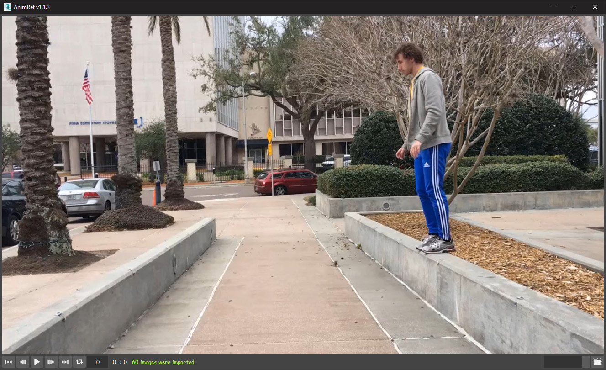

# AnimRef v1.0 — Sequence Loader for 3ds Max



AnimRef lets you load, play, and draw on image sequences directly inside 3ds Max — synced to the timeline.

---

## Features

- Load and play image sequences synced to the 3ds Max time slider
- Multi-layer drawing with opacity, eraser, undo/redo
- Ghost onion-skinning (forward and backward frames)
- Video-to-sequence converter (downloaded on demand)
- Export drawings per frame as PNG
- Time shift for offsetting the sequence relative to the timeline
- Adjustable window opacity

---

## Supported Formats

| Format | Description |
|--------|-------------|
| BMP    | Windows Bitmap |
| JPG / JPEG | Joint Photographic Experts Group |
| PNG    | Portable Network Graphics |

---

## Installation

### Option 1 — One-Click Installer (Recommended)

1. Download and extract the release ZIP so that `AnimRef.zip` and `One-Click Installation.bat` are in the **same folder**
2. **Right-click** `One-Click Installation.bat` → **Run as Administrator**
3. Press any key when prompted — the plugin installs automatically

### Option 2 — Manual

1. Extract `AnimRef.zip` into:
   ```
   C:\ProgramData\Autodesk\ApplicationPlugins\
   ```
   The result should be:
   ```
   C:\ProgramData\Autodesk\ApplicationPlugins\AnimRef\PackageContents.xml
   ```
2. Restart 3ds Max

---

## How to Launch

1. Open **3ds Max** (2025, 2026, 2027, or 2028)
2. Press **X** to open the search bar, type **AnimRef**
3. Click the result — or go to **Customize → Customize User Interface** to assign a keyboard shortcut

---

## Supported Versions

| 3ds Max Version | Status |
|-----------------|--------|
| 2025            | ✅ Supported |
| 2026            | ✅ Supported |
| 2027            | ✅ Supported |
| 2028            | ✅ Supported |